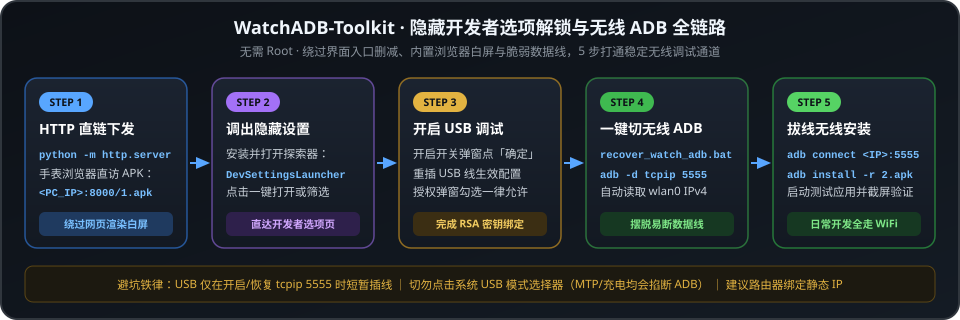
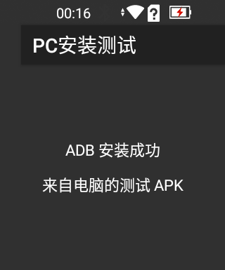
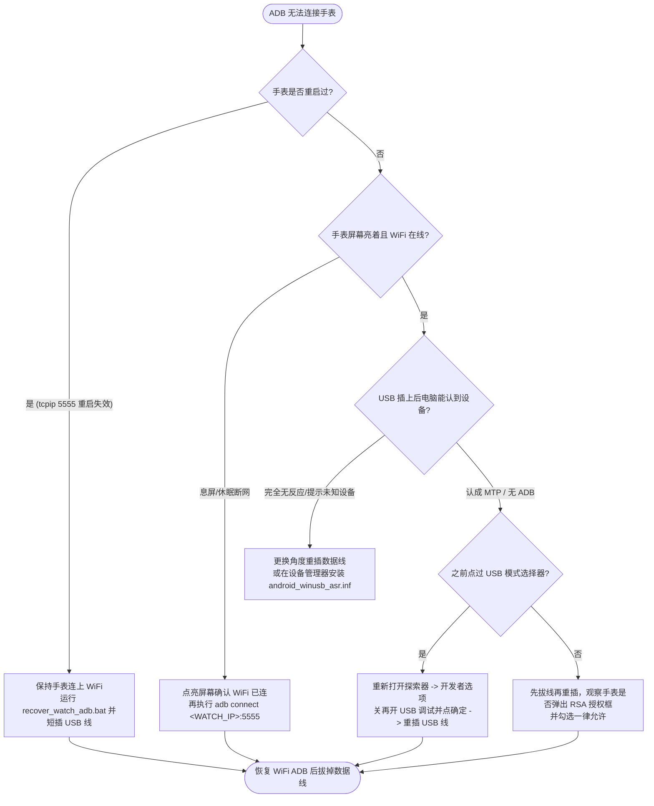

<div align="center">

# WatchADB-Toolkit

**针对隐藏了原生开发者选项的 Android 智能手表（重点适配翱捷 ASR 平台 / Watch AOS）的开发者设置探索器与 USB / WiFi ADB 调试工具箱**

[](LICENSE)
[](#适用设备)
[%20%26%20Generic-orange.svg)](#适用设备)
[](#从源码构建-apk)

</div>

---

## 目录

- [1. 项目背景与工作流全景](#1-项目背景与工作流全景)
- [2. 实机验证效果](#2-实机验证效果)
- [3. 适用设备](#3-适用设备)
- [4. 核心组件一览](#4-核心组件一览)
- [5. 使用说明](#5-使用说明)
  - [5.1 环境准备与工具获取](#51-环境准备与工具获取)
  - [5.2 首次从零开启 ADB（灾难恢复完整链路）](#52-首次从零开启-adb灾难恢复完整链路)
  - [5.3 日常无线 ADB 高频命令](#53-日常无线-adb-高频命令)
  - [5.4 常见故障恢复场景与排查决策树](#54-常见故障恢复场景与排查决策树)
  - [5.5 文件送入手表的通道与辅助工具用法](#55-文件送入手表的通道与辅助工具用法)
- [6. 文件地图](#6-文件地图)
- [7. 从源码构建 APK（无 Gradle 构建指南）](#7-从源码构建-apk无-gradle-构建指南)
- [8. 安全、隐私与机制说明](#8-安全隐私与机制说明)
- [9. 开源许可](#9-开源许可)

---

## 1. 项目背景与工作流全景

许多第三方定制或穿戴类 Android 手表固件（如基于 **Android 8.1 / Watch AOS** 的设备）会从系统设置界面中删去原生「开发者选项」入口（连续点击版本号通常只触发系统彩蛋而无法开启），同时伴随以下常见限制：

- 配件磁吸数据线极脆弱，轻碰即断；
- 内置浏览器高度精简，打开普通 HTML 网页往往直接白屏；
- MTP 默认不暴露存储或需要手动切换隐藏开关。

**WatchADB-Toolkit** 通过极简纯原生 Java 探索器（无任何第三方依赖、无 Gradle）直接扫描并调起 `com.android.settings` 中隐藏的开发者设置 Activity，配合直链 HTTP 分发、一键切无线 `tcpip` 恢复脚本、MTP 兜底传输脚本与补丁 WinUSB 驱动，打通稳定的 **WiFi 无线 ADB 调试链路**。

<p align="center">
  
</p>

---

## 2. 实机验证效果

在未 Root 的标准 `user` 版（`ro.debuggable=0`、`ro.adb.secure=1`）穿戴设备上实测通过：`DevSettingsLauncher` 成功调出隐藏开发者选项 → 打开 USB 调试并完成 RSA 授权 → 切换无线 `adb tcpip 5555` → 通过 WiFi 完成 `PCInstallTest.apk` 安装、启动与截屏回传验证。

<table>
  <tr>
    <td width="300" align="center">
      
      <br />
      <sub><code>PCInstallTest.apk</code> 无线安装并启动后的手表实机截屏</sub>
    </td>
    <td>
      <b>实测验证关键指标</b>
      <ul>
        <li><b>系统权限要求</b>：无需 Root，标准 <code>user</code> 安全版固件可用</li>
        <li><b>USB 调试通道</b>：Windows 11 可自动识别，异常时可使用仓库内 <code>driver/android_winusb_asr.inf</code> 补丁驱动</li>
        <li><b>WiFi 无线通道</b>：通过 <code>recover_watch_adb.bat</code> 一键切换至 TCP 端口（默认 <code>5555</code>）并读取手表局域网 IPv4</li>
        <li><b>安装链路验证</b>：<code>adb -s &lt;WATCH_IP&gt;:5555 install -r</code> 流式安装返回 <code>Success</code>，<code>am start</code> 拉起成功</li>
      </ul>
    </td>
  </tr>
</table>

---

## 3. 适用设备

### 兼容性矩阵

| 维度 | 适用范围与特征 | 说明 |
|---|---|---|
| **目标芯片 / USB ID** | **翱捷 ASR 芯片平台**（如 ASR8601，`VID_2ECC`）及同类定制 Android 手表 | 补丁驱动默认匹配 `VID_2ECC&PID_2001` 与标准 ADB 类 `Class_FF&SubClass_42&Prot_01` |
| **Android 版本** | **Android 4.2 ~ Android 14+**（`minSdkVersion=17`） | 实测平台为基于 Android 8.1 的 Watch AOS 定制固件 |
| **系统类型** | 标准量产 `user` 版（**无需 Root**） | 通过系统包管理器查询并启动已导出/同域设置页面 |
| **网络与安装前提** | 手表可连接与电脑同一局域网的 WiFi，且支持通过浏览器/MTP/蓝牙安装第三方 APK | 若系统完全禁止「未知来源」应用安装，则需先解除对应限制 |

> [!NOTE]
> `DevSettingsLauncher` 会依次尝试常见开发者设置入口（`DwDevelopSetActivity`、`Settings$DevelopmentSettingsActivity`、`DevelopmentSettings`、`Settings.ACTION_APPLICATION_DEVELOPMENT_SETTINGS`），若均被拦截，还会列出 `com.android.settings` 中的全部 Activity 供关键词筛选与逐一点击尝试，因此对非 ASR 芯片的其他定制 Android 手表同样有效。

### 不适用场景

- 非 Android 内核的 RTOS / 轻智能手环（无法运行 APK 与 `adbd`）。
- 固件已在编译阶段彻底移除 `adbd` 守护进程，或将开发者选项开关完全锁死在 SELinux / 系统签名权限中且禁止一切未知来源 APK 安装的设备。

---

## 4. 核心组件一览

| 组件 | 类型 | 作用 |
|---|---|---|
| **DevSettingsLauncher** (`devlaunch/`) | Android APK 源码 | 「设置页探索器」，一键直达隐藏开发者选项，或实时筛选 `com.android.settings` 全部 Activity |
| **PCInstallTest** (`pctest/`) | Android APK 源码 | 极简无线安装验证应用（启动后全屏显示 `ADB 安装成功`），用于端到端确认安装链路 |
| [recover_watch_adb.bat](recover_watch_adb.bat) | Windows 批处理 | 一键无线恢复脚本：等待 USB 设备 → `adb -d tcpip` → 自动读取 `wlan0` IPv4 → `adb connect` |
| [watch_adb_watchdog.bat](watch_adb_watchdog.bat) | Windows 批处理 | 轮询监视授权 ADB 设备上线或非 MTP USB PID 出现（默认过滤 `VID_2ECC` / `PID_2001`，支持自定义参数） |
| [copy_to_watch.ps1](copy_to_watch.ps1) | PowerShell 脚本 | MTP 兜底传文件脚本，针对接触不良数据线自动重试（纯 ASCII 实现，兼容 PS 5.1 与 PS 7+） |
| [scan_apk.py](scan_apk.py) | Python 3 工具 | 静态扫描 APK 内 `.dex`/`.arsc`/`.xml` 是否存在写 `adb_enabled`、`development_settings_enabled` 等操作 |
| [driver/android_winusb_asr.inf](driver/android_winusb_asr.inf) | Windows INF 驱动 | 针对 `VID_2ECC&PID_2001` 与通用 ADB 接口打过补丁的 Google WinUSB 驱动配置 |
| [dist/index.html](dist/index.html) | 极简下载页 | 纯 ASCII 极简入口页面，适配被阉割的穿戴设备内置浏览器 |

---

## 5. 使用说明

### 5.1 环境准备与工具获取

1. **电脑端基础工具**：
   - 安装 Android `platform-tools`（确保 `adb` 已加入系统 `PATH`）。
   - 安装 **Python 3**（用于启动本地临时 HTTP 文件服务器，将 APK 下发给手表）。
   - 若系统未能自动识别手表 ADB 驱动：打开「设备管理器」→ 右键未知/感叹号设备 → 更新驱动 → 浏览我的电脑以查找驱动程序 → 让我从计算机上的可用驱动程序列表中选取 → 从磁盘安装，选择 [driver/android_winusb_asr.inf](driver/android_winusb_asr.inf)。
2. **获取预编译 APK**（二选一）：
   - **方式 A（推荐）**：前往本仓库的 [**GitHub Releases**](https://github.com/213LD/WatchADB-Toolkit/releases) 下载 `DevSettingsLauncher.apk` 和 `PCInstallTest.apk`，放入本仓库的 `dist\` 目录，并分别另存或复制为 `dist\1.apk` 和 `dist\2.apk`（短文件名便于在手表小屏浏览器上输入）。
   - **方式 B（自行构建）**：在本地配置好 Android SDK 后，按 [第 7 节](#7-从源码构建-apk无-gradle-构建指南) 运行 `devlaunch\build.bat` 和 `pctest\build.bat`，脚本会自动将产物与 `1.apk` / `2.apk` 复制到 `dist\`。

---

### 5.2 首次从零开启 ADB（灾难恢复完整链路）

> [!IMPORTANT]
> 前提条件：手表与电脑连接在**同一个局域网 WiFi** 下，且网络未开启 AP 隔离。请将下方命令中的 `<PC_IP>` 替换为电脑的局域网 IPv4 地址，将 `<WATCH_IP>` 替换为手表的局域网 IPv4 地址。

1. **在电脑启动本地下载服务**：
   ```bat
   cd dist
   python -m http.server 8000
   ```
   保持该终端窗口开启（需确保 Windows 防火墙允许 Python 监听局域网 8000 端口）。
2. **手表下载并安装「设置页探索器」**：
   - 在手表浏览器地址栏**直接输入 APK 直链**：
     ```text
     http://<PC_IP>:8000/1.apk
     ```
   - 下载完成后点击安装包；若弹出「未知来源」拦截，按界面引导允许安装。
   > [!WARNING]
   > 许多穿戴设备内置浏览器的 WebView 渲染器被大幅精简，**打开常规 HTML 页面可能会直接白屏**。请优先输入 `.apk` 文件直链；若尝试网页入口，请仅访问纯 ASCII 的 `http://<PC_IP>:8000/`。
3. **调出隐藏的开发者选项**：
   - 在手表应用列表打开「开发者设置」（图标/名称为 `设置页探索器`）。
   - 点击 **「① 一键打开开发者选项」**。
   - 若该机型自定义了设置页类名，可在下方筛选框输入 `develop`、`dw`、`eng` 或 `factory`，逐个点击列表条目直达对应隐藏页面。
4. **开启 USB 调试（注意确认弹窗）**：
   - 进入开发者选项 → 打开 **USB 调试** 开关。
   - 弹出警告确认框时，**必须准确点击「确定」**；误触弹窗外部等同于取消，开关会自动弹回关闭状态。
5. **重插 USB 线并完成 RSA 授权**：
   - 打开开关后，**务必重新插拔一次 USB 数据线**（Android 的 USB 功能组合在连接握手时重新生成，仅拨开关不重插可能不会切换到 ADB 组合）。
   - 保持手表屏幕点亮，弹出「允许 USB 调试吗？」时勾选 **「一律允许使用这台计算机进行调试」** → 点击「确定」。
6. **切换无线 ADB 并拔线**：
   - 电脑端执行 `adb devices`，确认出现状态为 `device` 的 USB 设备。
   - 双击或运行 [recover_watch_adb.bat](recover_watch_adb.bat)（自动执行 `adb -d tcpip 5555`、读取手表 IP 并执行 `adb connect`）。
   - **拔掉脆弱的 USB 数据线**，后续安装、截屏、抓日志全部走 WiFi。

> [!TIP]
> - 强烈建议在路由器后台**为手表 MAC 地址绑定静态 DHCP IP**，避免每次重连 IP 变动。
> - 若要在另一台电脑上免授权继续调试，需重新用亮屏状态的手表确认一次 RSA 弹窗（或在可信环境迁移用户目录 `.android\adbkey` 与 `adbkey.pub`，**切勿将个人 `adbkey` 上传或分享给他人**）。

---

### 5.3 日常无线 ADB 高频命令

```bat
:: 1. 查看当前在线设备
adb devices

:: 2. 连接无线 ADB（若设备重启过或显示 offline，见 5.4 恢复流程）
adb connect <WATCH_IP>:5555

:: 3. 安装 APK（-r 覆盖安装，也可安装 dist\2.apk 进行测试）
adb -s <WATCH_IP>:5555 install -r path\to\app.apk

:: 4. 启动测试 APK 验证界面
adb -s <WATCH_IP>:5555 shell am start -n com.example.pctest/.MainActivity

:: 5. 截屏并拉回电脑
adb -s <WATCH_IP>:5555 shell screencap -p /sdcard/watch.png && adb -s <WATCH_IP>:5555 pull /sdcard/watch.png .

:: 6. 卸载测试 APK
adb -s <WATCH_IP>:5555 uninstall com.example.pctest
```

---

### 5.4 常见故障恢复场景与排查决策树

#### 常见场景速查

- **场景 A：手表重启后 WiFi ADB 连不上（`connection refused` / `offline`）**
  1. 确保手表已连回 WiFi，然后运行 [recover_watch_adb.bat](recover_watch_adb.bat)（支持可选端口参数，如 `recover_watch_adb.bat 5555`）。
  2. 短暂插一下 USB 线，脚本会自动等待 USB ADB 就绪、切至 `tcpip 5555`、读取 `wlan0` IPv4 并完成无线重连，完成后即可拔线。
- **场景 B：USB 调试开关显示已开启，但电脑 `adb devices` 始终看不到**
  1. **重新插拔一次 USB 线**，确保屏幕亮着且能看到 RSA 授权弹窗。
  2. **切勿进入系统的「USB 模式选择器」（MTP / 仅充电 / 网络共享）**——这类页面中的三个选项往往都不含 ADB 组合，点击一次就会把当前 `adb` USB 配置覆盖掉。
  3. 检查 Windows 设备管理器是否存在未识别的 Android 设备，如有则指定 [driver/android_winusb_asr.inf](driver/android_winusb_asr.inf)。
- **场景 C：手表恢复出厂设置，探索器与调试状态全部清空**
  - 重新走一遍 [5.2 首次从零开启 ADB](#52-首次从零开启-adb灾难恢复完整链路) 即可（约 5~10 分钟）。

#### 故障排查决策树



---

### 5.5 文件送入手表的通道与辅助工具用法

按稳定性与便捷程度排序：

1. **WiFi ADB（首选）**：`adb install` / `adb push`
2. **HTTP 直链（初始化必备）**：`cd dist && python -m http.server 8000`
3. **MTP 兜底脚本（[copy_to_watch.ps1](copy_to_watch.ps1)）**：
   适用于浏览器损坏但可打开手表「文件存储访问」的场景（需解锁亮屏）：
   ```powershell
   powershell -ExecutionPolicy Bypass -File .\copy_to_watch.ps1 -SourcePath .\dist\1.apk
   # 可选自定义设备名匹配正则与重试次数：
   powershell -ExecutionPolicy Bypass -File .\copy_to_watch.ps1 -SourcePath .\dist\1.apk -DevicePattern "MTP|Watch|Android" -MaxAttempts 8
   ```
4. **USB/ADB 上线监视器（[watch_adb_watchdog.bat](watch_adb_watchdog.bat)）**：
   在排查接触不良数据线或等待新 USB PID 出现时使用：
   ```bat
   :: 默认监视授权 ADB 设备或 VID_2ECC 出现非 PID_2001 的复合设备（最多约 5 分钟）
   watch_adb_watchdog.bat

   :: 自定义 VID/PID 过滤或传入 NONE 仅监视 ADB 设备：
   watch_adb_watchdog.bat NONE
   ```
5. **APK 静默改写扫描器（[scan_apk.py](scan_apk.py)）**：
   用于排查设备中预装系统应用是否存在写入 `adb_enabled`、`development_settings_enabled` 等恢复逻辑：
   ```bash
   python scan_apk.py path/to/Settings.apk --extra persist.sys.usb.config
   ```

---

## 6. 文件地图

```text
WatchADB-Toolkit/
├── README.md                                  # 项目说明、图文教程与避坑手册（本文档）
├── LICENSE                                    # MIT 开源许可证（Copyright (c) 2026 213LD）
├── .gitignore                                 # 忽略厂商闭源 APK、keystore 私钥、编译中间产物
├── .gitattributes                             # 规范跨平台换行符（bat/ps1/inf 强制 CRLF）
├── recover_watch_adb.bat                      # 一键切无线 tcpip 并自动连接 WiFi ADB
├── watch_adb_watchdog.bat                     # 轮询监视 ADB 上线或 USB PID 变化
├── copy_to_watch.ps1                          # MTP 自动重试拷文件脚本（兜底通道）
├── scan_apk.py                                # APK 关键词扫描器（排查开发者设置写入行为）
├── docs/
│   └── images/
│       ├── workflow.svg                       # 5 步解锁与无线 ADB 全链路流程图
│       └── watch_screen.png                   # 测试 APK 在实机上运行成功的截屏
├── driver/
│   └── android_winusb_asr.inf                 # 补丁 ADB WinUSB 驱动（VID_2ECC + 通用 ADB 类）
├── dist/
│   ├── index.html                             # 纯 ASCII 极简下载入口页（防手表浏览器白屏）
│   └── (1.apk / 2.apk)                        # 本地 HTTP 服务短名包（由 Releases 下载或构建生成）
├── devlaunch/                                 # 「设置页探索器」源码与零 Gradle 构建脚本
│   ├── AndroidManifest.xml
│   ├── build.bat                              # 构建并输出 DevSettingsLauncher.apk + dist\1.apk
│   └── src/com/example/devlaunch/
│       ├── LaunchActivity.java                # 一键打开开发者选项 + Activity 列表过滤启动
│       └── MyAdapter.java                     # 顶层具名 Adapter（规避 d8 匿名内部类问题）
└── pctest/                                    # 无线安装测试 APK 源码与零 Gradle 构建脚本
    ├── AndroidManifest.xml
    ├── build.bat                              # 构建并输出 PCInstallTest.apk + dist\2.apk
    └── src/com/example/pctest/
        └── MainActivity.java                  # 启动后全屏显示 "ADB 安装成功"
```

---

## 7. 从源码构建 APK（无 Gradle 构建指南）

为了保持体积极简（单个 APK 仅约 8~13 KB）且不引入数十 MB 的 Gradle Wrapper，两个 APK 均采用 Android SDK `build-tools` 纯命令行流水线构建：

`aapt2 link` → `javac -encoding UTF-8 -source 8 -target 8` → `d8 --min-api 17` → 注入 `classes.dex` → `zipalign` → `apksigner`

### 构建前提

- 已安装 JDK（推荐 JDK 17 / 21）与 Android SDK（包含任意可用版本的 `build-tools` 与 `platforms/android-*`）。
- 已设置 `ANDROID_HOME` 或 `ANDROID_SDK_ROOT`（未设置时脚本会自动尝试 `%LOCALAPPDATA%\Android\Sdk`）。

### 执行构建

```bat
:: 构建 设置页探索器（自动输出至 devlaunch\DevSettingsLauncher.apk 及 dist\1.apk）
devlaunch\build.bat

:: 构建 安装测试 APK（自动输出至 pctest\PCInstallTest.apk 及 dist\2.apk）
pctest\build.bat
```

脚本支持通过环境变量覆盖默认配置（无需修改任何代码）：

| 环境变量 | 说明 | 默认行为 |
|---|---|---|
| `ANDROID_HOME` / `ANDROID_SDK_ROOT` | Android SDK 根目录 | 自动探测 `%LOCALAPPDATA%\Android\Sdk` |
| `BUILD_TOOLS` | 指定 `build-tools\<version>` 目录 | 自动选择已安装的最高版本 |
| `ANDROID_JAR` | 指定 `android.jar` 完整路径 | 自动选择已安装的最高 `platforms\android-*` |
| `KEYSTORE` | 签名 keystore 路径 | 默认在仓库根目录按需自动生成临时 `debug.keystore`（已列入 `.gitignore`） |
| `KEY_ALIAS` / `KS_PASS` / `KEY_PASS` | 签名别名与口令 | 默认使用标准 debug 参数 `androiddebugkey` / `android` |

### 命令行构建踩坑附录（二次开发必读）

> [!CAUTION]
> 修改 Java 源码时请务必遵守以下规则，否则无 Gradle 构建链路会直接报错：
> 1. **禁止使用 Lambda 表达式与方法引用**：以 `android.jar` 作为 `bootclasspath` 时缺少完整 `LambdaMetafactory` 支持，会导致编译或运行时异常。
> 2. **禁止使用匿名内部类**：匿名内部类产生的 `Foo$1.class` 在部分 `d8` 版本下会触发 NPE，所有监听回调请由 Activity 主类直接 `implements`，ListView 适配器请保持为独立具名类（如 [MyAdapter.java](devlaunch/src/com/example/devlaunch/MyAdapter.java)）。
> 3. **Windows 批处理调用 `.bat` 子工具必须加 `call`**：如 `d8.bat` 与 `apksigner.bat`，不加 `call` 会导致脚本提前静默退出。
> 4. **UTF-8 编码**：`javac` 必须带 `-encoding UTF-8`，否则在中文 Windows 默认 GBK 代码页下界面文案会乱码；`.ps1` 脚本如包含非 ASCII 字符必须使用 UTF-8 with BOM 或 `\uXXXX` Unicode 转义。

---

## 8. 安全、隐私与机制说明

- **仓库纯净性**：本公开仓库**不包含**任何第三方厂商闭源系统 APK、个人签名私钥（`*.keystore`）、本机 ADB 授权密钥（`adbkey`）或具体个人设备的序列号 / IMEI / 内网地址。
- **关于「开发者选项疑似自动关闭 / 复原」的机制排查**：
  部分用户会误以为固件存在后台定时还原 `adb_enabled` 的守护进程。实际上对系统设置与工程组件的 `.dex` / 资源扫描（可使用 [scan_apk.py](scan_apk.py) 对目标固件自查）表明，常见「复原」假象通常来自两个 UI 陷阱叠加：
  1. 开启 USB 调试弹出的确认框若误触框外区域，等同于点击「取消」，开关会立即弹回；
  2. 点开系统「USB 模式选择器」并选择 MTP/充电后，系统会重写 `sys.usb.config` 为不含 `adb` 的组合，导致 ADB 立刻断开。

---

## 9. 开源许可

- 本项目自研源码、构建脚本、辅助工具与文档采用 **[MIT License](LICENSE)** 开源（`Copyright (c) 2026 213LD`）。
- **第三方组件声明**：[driver/android_winusb_asr.inf](driver/android_winusb_asr.inf) 基于 Google 官方发布的 Android USB Driver（`android_winusb.inf`，依据 **Apache License 2.0** 分发）修改，仅补充了 `VID_2ECC&PID_2001` 与通用 ADB 类硬件 ID 匹配项。
